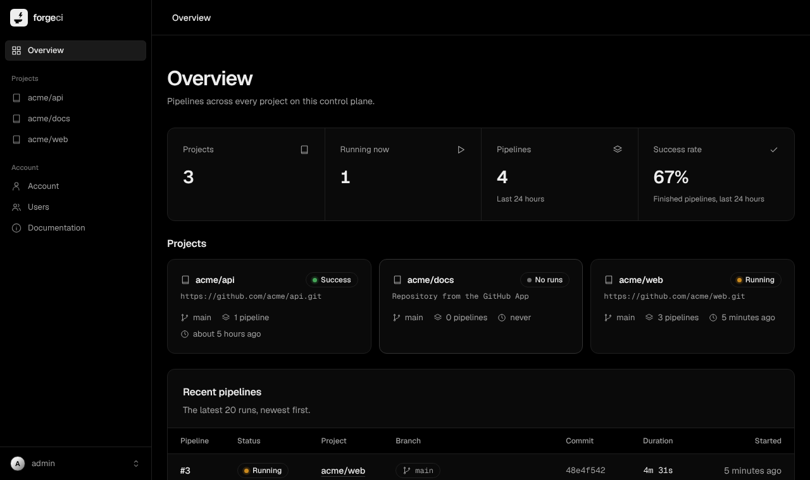

<p align="center">
  
</p>

<h1 align="center">ForgeCI</h1>

<p align="center">
  <strong>CircleCI-compatible CI/CD you run yourself.</strong><br>
  Your <code>.circleci/config.yml</code>, your runners, your storage. Pure Ruby, MIT licensed.
</p>

<p align="center">
  <a href="https://github.com/azmi2409/forge-ci/actions/workflows/ci.yml"></a>
  <a href="MIT-LICENSE"></a>
  <a href="https://www.ruby-lang.org/">= 3.0"></a>
  <a href="CONTRIBUTING.md"></a>
</p>

<p align="center">
  <a href="#quickstart">Quickstart</a> ·
  <a href="DEPLOY.md">Deploy</a> ·
  <a href="docs/compiler.md#supported-subset-vs-circleci">Compatibility</a> ·
  <a href="docs/agent-skills.md">Agent skills</a> ·
  <a href="#documentation">Docs</a> ·
  <a href="CONTRIBUTING.md">Contributing</a>
</p>



Push to GitHub and ForgeCI compiles your config, Docker runners on your own
machines claim the jobs, logs stream live, and a commit status goes back to
the pull request. Runners need no inbound ports, and there's no hosted
control plane.

## What you get

- **Your CircleCI config as is.** Executors, commands, parameters,
  workflows, `requires`, `matrix`, filters, contexts, caches, workspaces and
  artifacts. Unsupported features fail with a clear error:
  [compatibility table](docs/compiler.md#supported-subset-vs-circleci).
- **Runners anywhere.** They poll over outbound HTTPS, so they work behind
  NAT. `resource_class` routes jobs, for example checks on Spot and deploys
  on-demand.
- **Parallel test splitting.** `parallelism: N` with `circleci tests glob`,
  `split` and `run`.
- **Scale to zero.** Idle runners remove themselves; the control plane scales
  them back up when jobs queue. Only tested with AWS EC2 Spot runners so far
  (see [TODO.md](TODO.md#tested-so-far)).
- **Registry-backed Docker layer caching.** `docker_layer_caching: true`
  exports image layers to your registry during a build and restores them on
  the next runner, so Spot reclamation never costs a full rebuild
  (see [configuration](docs/configuration.md#docker-layer-caching)).
- **Secrets done carefully.** Contexts are encrypted, masked in logs and never
  given to pull requests from forks.
- **GitHub native.** Pipelines on push and pull request, private repos and
  commit statuses.
- **Agent-ready.** A bundled skill teaches Claude Code and other coding agents
  to write, validate and run your pipeline.

## Quickstart

```sh
git clone https://github.com/azmi2409/forge-ci && cd forge-ci
docker compose up -d --wait   # waits until ForgeCI is ready (first boot: a minute or two)
docker compose exec web bin/rails forge_ci:reset_admin   # prints the admin password
# → http://localhost:3000
```

Nothing to configure: secrets are generated on first boot. Then, in the web
UI, **Settings → Connect GitHub**. To run jobs on the same machine, use
`RUNNERS=1 docker compose up -d` (or put `RUNNERS=1` in `.env`); for other
machines, paste the command from **Settings → Runners**. For a real server (HTTPS,
Coolify, S3, scaling to zero) see **[DEPLOY.md](DEPLOY.md)**.

## Use it with your repo

- **With the GitHub App:** connect it under Settings, install it and push.
  The first push creates the project.
- **From any script, without the App:** `forge-ci trigger .circleci/config.yml --project myapp --wait`
  ([setup](DEPLOY.md#use-it-without-the-github-app)).

Check a config locally first; the compiler needs only Ruby 3.0+. `gem install`
puts the `forge-ci` CLI on your PATH:

```sh
gem install forge-ci
forge-ci validate .circleci/config.yml
forge-ci compile .circleci/config.yml --branch main   # the jobs that will run on main
```

Working from a checkout of this repo? `rake install` builds the gem from
source and installs it the same way (`rake build` just produces the `.gem`).

```yaml
# .circleci/config.yml
version: 2.1
jobs:
  test:
    docker:
      - image: cimg/ruby:3.3
    working_directory: /home/circleci/project   # absolute: cimg images run as circleci
    resource_class: spot
    parallelism: 4
    steps:
      - checkout
      - run: bundle install
      - run: |
          circleci tests glob "test/**/*_test.rb" |
            circleci tests run --split-by=filesize --command="xargs bin/rails test"
workflows:
  ci:
    jobs: [test]
```

## Agent skills

Give your coding agent the ForgeCI skill, then commit it:

```sh
forge-ci skill install          # Claude Code: .claude/skills/forge-ci/SKILL.md
forge-ci skill show >> AGENTS.md   # Codex and other agents that read AGENTS.md
```

Add your repository's own rules under "Repository notes" at the end of the
skill. Other agents, a personal install and installing without the gem are
covered in [docs/agent-skills.md](docs/agent-skills.md).

## Documentation

| Doc | What |
|---|---|
| [DEPLOY.md](DEPLOY.md) | Deploying in three steps, plus Postgres, S3 and scaling to zero |
| [docs/compiler.md](docs/compiler.md) | The compiler gem and CLI, IR shape, compatibility with CircleCI |
| [docs/agent-skills.md](docs/agent-skills.md) | Installing the skill for Claude Code and other agents |
| [docs/configuration.md](docs/configuration.md) | Every environment variable |
| [docs/api.md](docs/api.md) | The REST API and the runner contract |
| [docs/architecture.md](docs/architecture.md) | How it works: compiler, state machines, claims, secrets |
| [docs/troubleshooting.md](docs/troubleshooting.md) | Common problems and fixes |
| [TODO.md](TODO.md) | What's left |

The repository holds the compiler gem and CLI (root), the Rails control plane
([`web/`](web/README.md)), the runner ([`runner/`](runner/README.md)) and the
agent skill (`skills/`). All 8 planned components are built and tested.

## Contributing

PRs are welcome against `main`, with all three test suites green. Start with
[CONTRIBUTING.md](CONTRIBUTING.md).

```sh
rake test                                                       # compiler gem
cd web && DATABASE_URL="sqlite3:db/test.sqlite3" bin/rails test   # control plane
cd runner && rake test                                          # runner
```

## License

MIT. See [MIT-LICENSE](MIT-LICENSE).
